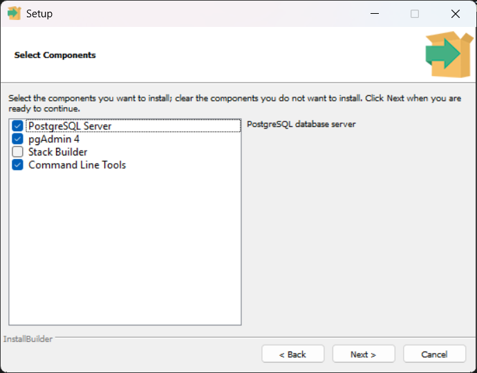
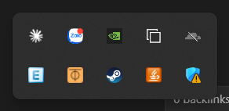
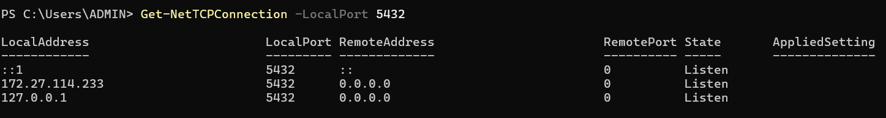

# Setup
Download PostgreSQL Version 18 Installer for Windows 64bit (32bit is unsupported). 

Remember to keep:
- PostgreSQL Server: the actual database
- pgAdmin 4: GUI for the database, this is local
- Command Line Tools: use the database via terminals

Stack Builder is for tools and extensions. We use basic PostgreSQL so no need. 
# Connection
We need to use ZeroTier to have a virtual LAN for PostgreSQL to be able to listen to connections securely. We still have to change what it listens to, which only includes `localhost` by default, To do this we must first download ZeroTier, which will only exist in the hidden icon tray:

- Then we will connect to this network: `af78bf9436316348` and wait for authorization from me (Hazarral)

Next, to change the network which the postgreSQL database listen to:
- Go to `C:\Program Files\PostgreSQL\[Version]\data\postgresql.conf`, with `[Version]` as `18` in our case, so the full path is `C:\Program Files\PostgreSQL\18\data\postgresql.conf`
- Change `listen_addresses = '*'` to `listen_addresses = 'localhost, 172.27.114.233'`, which is my IPv4 given to me by the ZeroTier network
- Go into `Services.msc` and find `postgresql-x64-18` and restart it
- In Powershell/Command Prompt, use the command below to check for successful connection:
```
Get-NetTCPConnection -LocalPort 5432
```
My result:


